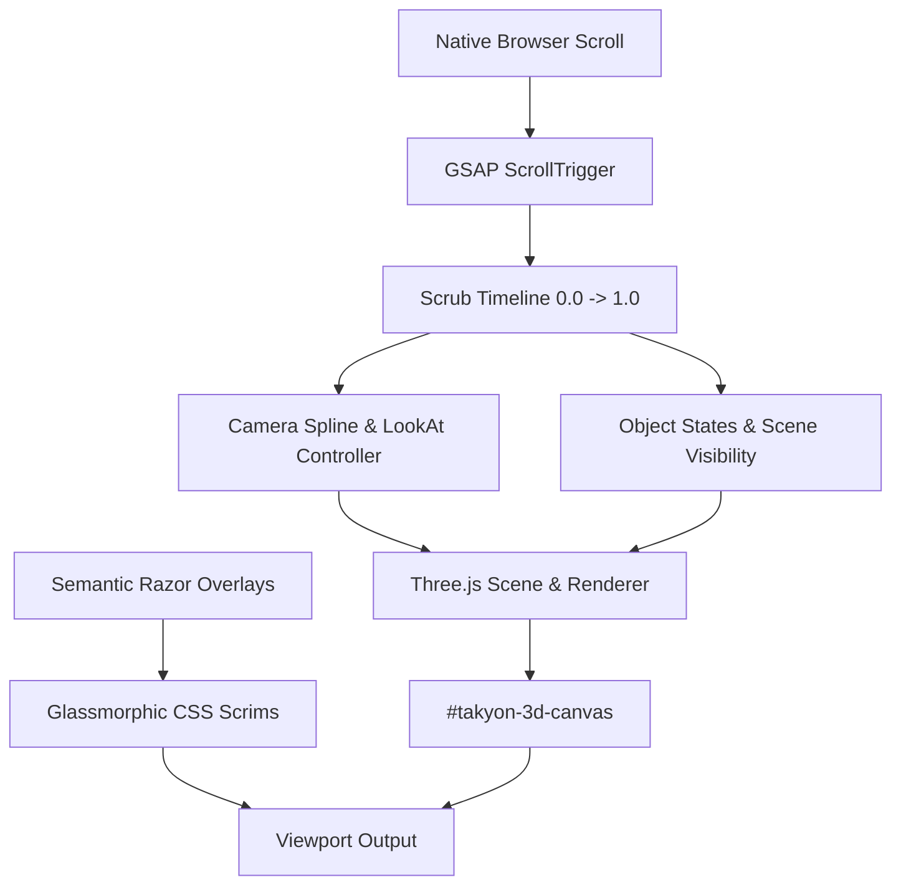

# Takyon 3D Experience — Technical Requirements Document (TRD)

## 1. Technical Stack & Architecture

- **Rendering Engine:** Three.js r128 (self-hosted in `wwwroot/lib/three/three.min.js`).
- **Scroll Orchestration:** GSAP 3.12.5 + ScrollTrigger plugin (self-hosted in `wwwroot/lib/gsap/`).
- **Markup & Server:** ASP.NET Core Razor Pages (.NET 10.0).
- **Execution Model:** Client-side WebGL canvas driven by `wwwroot/js/takyon-3d-journey.js` synchronized with native document scroll.



---

## 2. WebGL Performance Strategy

1. **Zero External Assets:**
   - 100% procedural Three.js geometry (`BufferGeometry`, `InstancedMesh`, `LineSegments`, `Points`).
   - Zero external `.glb`/`.gltf` model downloads, eliminating network latency and 404 risks.
2. **Batching & Instancing:**
   - Server racks in Scene 4 use `THREE.InstancedMesh` (rendering 40+ racks in a single draw call).
   - Network nodes use `THREE.Points` or `THREE.InstancedMesh` with matrix transforms.
3. **Optimized Particle Systems:**
   - Particle positions and colors are stored in shared `Float32Array` attributes.
   - Point sizes are scaled according to device pixel ratio (`Math.min(window.devicePixelRatio, 2)`).
4. **Scene Partitioning & Occlusion:**
   - Elements for distant scenes are hidden (`visible = false`) when outside their active scroll range, keeping active draw calls under 30.
5. **Memory Management & Disposal:**
   - Geometries, materials, and textures implement explicit disposal when the 3D toggle is set to `OFF`.
   - The `requestAnimationFrame` loop pauses when the canvas is hidden or off-screen.

---

## 3. Camera Paths & Scrubbing Coordinates

A single camera controller scrubs along a continuous Bezier curve through 3D space:

| Scene | Scroll Progress | Camera Position (x, y, z) | LookAt Target (x, y, z) | Active Scene Elements |
|---|---|---|---|---|
| **1. Hero** | 0.00 – 0.10 | `(0, 5, 45)` | `(0, 0, 0)` | Hero Constellation, data links |
| **2. Enterprise Net** | 0.10 – 0.22 | `(0, 2, 25)` | `(0, -2, 0)` | Wireframe Campus Building, fiber risers |
| **3. Cyber Security** | 0.22 – 0.34 | `(-12, 4, 18)` | `(0, 1, 0)` | Geodesic Shield Dome, threat deflection |
| **4. Data Center** | 0.34 – 0.46 | `(0, 0, 12)` | `(0, 0, -30)` | Instanced Server Corridor, cooling particles |
| **5. Surveillance** | 0.46 – 0.58 | `(15, 12, 18)` | `(0, -2, 0)` | Isometric Ground Grid, volumetric cones |
| **6. Cloud & Managed**| 0.58 – 0.70 | `(0, 18, 22)` | `(0, 14, 0)` | Floating Cloud Nodes, 24/7 orbital ring |
| **7. AV & Collab** | 0.70 – 0.80 | `(-8, 3, 14)` | `(4, 2, 0)` | Smart Boardroom, active display wall |
| **8. Pan-India Trust** | 0.80 – 0.90 | `(0, 15, 38)` | `(0, 0, 0)` | Pan-India Regional Mesh, stat nodes |
| **9. Final B2B Hub** | 0.90 – 1.00 | `(0, 10, 50)` | `(0, 2, 0)` | Global Integrated Ecosystem |

---

## 4. ViewModel Data Contract Integration

The page overlays bind directly to existing properties on `IndexModel`:
- `Model.Overview`: BSE Listed status, CMMI Level 3, Founded Year, Mission, Tagline.
- `Model.CoreSolutions`: Filtered to the 6 core brochure solutions (where `IsFeatured == true`).
- `Model.FeaturedIndustries`: Top 6 industry verticals with icons and focus tags.
- `Model.FeaturedProjects`: Notable case studies with client names and project scopes.
- `Model.FeaturedPartners`: Verified OEM technology alliances (Dell, Cisco, Fortinet, AWS, etc.).

---

## 5. Reduced-Motion & Error Recovery Protocol

```javascript
// Reduced Motion Detection
const prefersReduced = window.matchMedia('(prefers-reduced-motion: reduce)').matches;
if (prefersReduced || !hasWebGLSupport()) {
    enableStaticFallbackMode();
}
```

When fallback mode is active:
1. WebGL renderer does not initialize or pauses render loop.
2. Canvas is set to `display: none`.
3. Background defaults to rich CSS gradient with subtle grid pattern.
4. Glassmorphic cards remain fully styled, responsive, and readable.
5. All click-to-scroll anchors continue to function identically.
