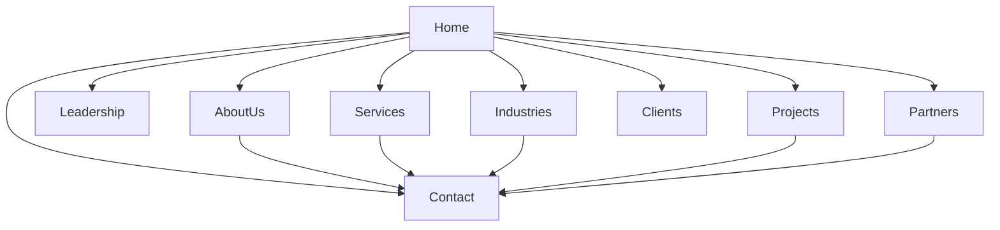

# Takyon — UI/UX Design Specification

## 1. Design Objective

Create a modern, professional, responsive corporate website for Takyon Networks Limited.

The visual design must follow the updated company profile, while the A4 brochure provides project imagery and supporting business content.

The design should communicate:

- Trust and reliability.
- Technical expertise.
- Corporate professionalism.
- Innovation and integration.
- Clear, accessible information.
- Consistency across all pages.

Do not copy the PDF page layouts literally. Adapt their visual identity to a responsive website.

## 2. Design References

### Primary reference
`company profile updated(1).pdf`

Use this document for:
- Brand colors.
- Typography hierarchy.
- Company overview.
- Leadership presentation.
- Service cards.
- Industry presentation.
- Client and OEM logo layouts.

### Supporting reference
`TAKYON BROCHURE A4 Size Colour Change(1).pdf`

Use this document for:
- Project imagery.
- Project names and scopes.
- Company credentials.
- Government empanelment information.
- Approved corporate contact details.

## 3. Proposed Color Palette

These are proposed approximations based on the PDF appearance, not confirmed official brand tokens.

| Token | Proposed value | Usage |
|---|---|---|
| Primary Blue | `#078BC5` | Primary buttons, links, headings |
| Deep Navy | `#12345B` | Strong text and dark sections |
| Brand Green | `#83C341` | Accent lines and highlights |
| Dark Green | `#28764B` | Green headings and emphasis |
| White | `#FFFFFF` | Main card and page backgrounds |
| Light Neutral | `#F4F6F8` | Alternate sections |
| Border | `#DCE4EA` | Card and form borders |
| Body Text | `#273746` | Main paragraph text |
| Muted Text | `#5E6B75` | Secondary information |
| Error | `#B42318` | Validation errors |
| Success | `#247A45` | Success feedback |

### Color Rules

- Use blue as the main interactive color.
- Use green as a supporting accent.
- Keep paragraph text sufficiently dark.
- Avoid low-contrast green text on white.
- Verify contrast ratios during implementation.
- Centralize color values using CSS custom properties.

## 4. Typography

Use a modern sans-serif font stack.

Recommended fallback stack:

`system-ui, -apple-system, "Segoe UI", Roboto, Arial, sans-serif`

### Typography hierarchy

- Display heading: primary hero heading.
- H1: page title.
- H2: major section title.
- H3: card or subsection title.
- Body: paragraphs and descriptions.
- Small text: metadata and supporting information.

### Typography rules

- Keep headings short and readable.
- Use consistent font weights.
- Use approximately 1.5–1.7 line-height for body text.
- Avoid long paragraphs without section breaks.
- Do not introduce a remote font dependency without justification.

## 5. Spacing and Layout

Use Bootstrap 5's responsive containers, grid system, and spacing utilities.

Proposed spacing scale:

- 4 px
- 8 px
- 12 px
- 16 px
- 24 px
- 32 px
- 48 px
- 64 px

### Layout rules

- Use a consistent content width.
- Provide generous spacing between sections.
- Keep cards aligned within their grids.
- Use consistent border radii and padding.
- Avoid excessive shadows and gradients.
- Maintain consistent vertical rhythm across pages.

## 6. Reusable Components

### 6.1 Site Header

Responsibilities:
- Display the approved Takyon logo.
- Provide primary navigation.
- Include a mobile navigation toggle.
- Provide a Contact call to action if appropriate.

Requirements:
- Responsive Bootstrap 5 navigation.
- Keyboard-accessible controls.
- Visible focus states.
- Correct active-page indication where appropriate.

### 6.2 Site Footer

Responsibilities:
- Display approved company contact information.
- Provide links to confirmed public pages.
- Include newsletter UI if approved.
- Include legal links only when destinations are confirmed.

Do not invent privacy-policy or regulatory URLs.

### 6.3 Page Hero

Contains:
- Page title.
- Short introduction.
- Optional approved image.
- Optional breadcrumb navigation.

Use a consistent layout across pages.

### 6.4 Section Heading

Contains:
- Section title.
- Optional subtitle.
- Optional blue or green accent rule.

### 6.5 Solution Card

Contains:
- Icon.
- Solution title.
- Short description.
- Optional details link.

All solution cards must share consistent spacing and typography.

### 6.6 Industry Card

Contains:
- Industry title.
- Optional icon.
- Source-supported description.

### 6.7 Project Card

Contains:
- Project name.
- Client or organization.
- Project scope.
- Optional industry label.
- Approved project image.

Do not display fabricated project metrics.

### 6.8 Leadership Card

Contains:
- Approved portrait, if available.
- Name.
- Official title.
- Short biography, if supported.

Do not guess titles or biographies.

### 6.9 Client and Partner Logo Grids

Requirements:
- Consistent logo sizing.
- Responsive grid.
- Accessible logo descriptions.
- Local assets rather than remote image hotlinks.
- No misleading endorsement language.

### 6.10 Contact Information Card

Contains:
- Office name.
- Approved address.
- Approved phone number.
- Approved email address, if available.

### 6.11 Form Field

Contains:
- Explicit label.
- Input or textarea.
- Optional help text.
- Validation message.

Placeholders must not replace labels.

### 6.12 Status Message

Support:
- Information.
- Validation error.
- Success.
- Demo-only notice.

Status must not rely on color alone.

## 7. Page-by-Page Layout

## 7.1 Home Page

Recommended section order:

1. Site header.
2. Hero section.
3. Company introduction.
4. Approved credibility indicators.
5. Core solutions.
6. Industry verticals.
7. Selected notable projects.
8. OEM partner highlights.
9. Contact call to action.
10. Site footer.

### Hero guidance

- Present the company clearly.
- Use a concise, source-supported value proposition.
- Include a primary link to Services.
- Include a secondary link to Contact.
- Use approved infrastructure or technology imagery.

Avoid invented statistics or unsupported claims.

## 7.2 About Us

Recommended sections:

1. Page hero.
2. Company overview.
3. Company history or milestones, if supported.
4. Mission and vision.
5. Core values.
6. Geographic presence, if verified.
7. Contact call to action.

Keep long descriptions readable and organized.

## 7.3 Leadership

Recommended sections:

1. Page hero.
2. Leadership introduction.
3. Responsive leadership card grid.
4. Contact call to action.

Use consistent portrait dimensions.

If a portrait is unavailable, use a neutral layout rather than a fabricated photograph.

## 7.4 Services

Recommended sections:

1. Page hero.
2. Services introduction.
3. Solution card grid.
4. Relevant supporting imagery.
5. Contact call to action.

The final service taxonomy must be confirmed because the source profile shows more than six categories.

Do not silently omit or combine categories.

## 7.5 Industries

Recommended sections:

1. Page hero.
2. Industry introduction.
3. Responsive industry card grid.
4. Relevant approved project references, if appropriate.
5. Contact call to action.

Avoid suggesting a client relationship that the source does not establish.

## 7.6 Projects

Recommended sections:

1. Page hero.
2. Introduction to project experience.
3. Project card grid.
4. Optional filtering if the number of projects justifies it.
5. Contact call to action.

Each card should preserve source-supported project names and scopes.

Do not invent case-study results or performance metrics.

## 7.7 Clients

Recommended sections:

1. Page hero.
2. Short introduction.
3. Client logo grid.
4. Contact call to action.

Keep logo sizes visually balanced without distorting their proportions.

## 7.8 Partners

Recommended sections:

1. Page hero.
2. Partnership introduction.
3. OEM partner logo grid.
4. Contact call to action.

Use approved logos and consistent spacing.

## 7.9 Contact

Recommended sections:

1. Page hero.
2. Approved office contact information.
3. Contact form.
4. Optional newsletter component.
5. Contact QR component only after its payload is confirmed.

### Contact form fields

Proposed fields, subject to confirmation:

- Name.
- Email address.
- Organization.
- Message.

Organization is optional unless approved requirements specify otherwise.

Do not add unsupported form fields without a clear need.

### Demo submission behavior

After valid client-side submission, display a clear message such as:

"Your form passed frontend validation. This demonstration does not send or store your message."

Do not claim that a real inquiry was submitted.

## 8. Navigation Map

Use the same primary navigation structure across all public pages.

## 9. Responsive Design

### Mobile: below 768 px

- Collapsed navigation.
- Single-column content where appropriate.
- Full-width form controls.
- Readable heading sizes.
- Touch-friendly controls.
- No hover-only functionality.
- Correct image scaling.

### Tablet: 768–991 px

- Two-column card grids where appropriate.
- Balanced content spacing.
- Navigation appropriate to the available width.
- No cramped text or logo grids.

### Desktop: 992 px and above

- Full navigation where it fits.
- Multi-column card grids.
- Consistent content width.
- Balanced hero composition.
- Clear section separation.

### Required viewport checks

Test at:

- 320 px.
- 375 px.
- 768 px.
- 1024 px.
- 1440 px.

Verify that no page has unintended horizontal overflow.

## 10. Accessibility Requirements

- Use semantic HTML landmarks.
- Maintain logical heading order.
- Provide keyboard-accessible navigation.
- Use visible focus indicators.
- Associate validation messages with the relevant form fields.
- Use meaningful alt text for informative images.
- Use empty alt text for decorative images.
- Do not rely on color alone to communicate status.
- Respect reduced-motion preferences.
- Target WCAG 2.2 AA where practical.

## 11. UX States

### Loading

Static content should not display unnecessary loading spinners.

### Empty

Do not fill missing business content with fabricated examples.

### Error

Display clear field-level validation errors.

### Success

Distinguish frontend validation success from real server-side submission.

### Focus and Hover

Maintain consistent visual feedback.

All essential interactions must work without a mouse.

## 12. Asset Management

Store approved assets under:

`wwwroot/images/`

Use descriptive filenames, for example:

- `takyon-logo.svg`
- `project-aiims-bibinagar.jpg`
- `project-hal-lucknow.jpg`
- `partner-microsoft.svg`

These names are examples only; use the actual approved assets that exist.

Requirements:

- Do not invent missing assets.
- Do not distort logos.
- Avoid remote image hotlinks.
- Optimize image sizes.
- Preserve source and usage information where available.

## 13. Final Design Acceptance Criteria

- Branding is consistent with the updated profile.
- Components use a shared visual system.
- Every confirmed page is responsive.
- Navigation and forms are accessible.
- No unsupported business claims are introduced.
- Logo and image assets load correctly.
- No critical layout issues remain.
