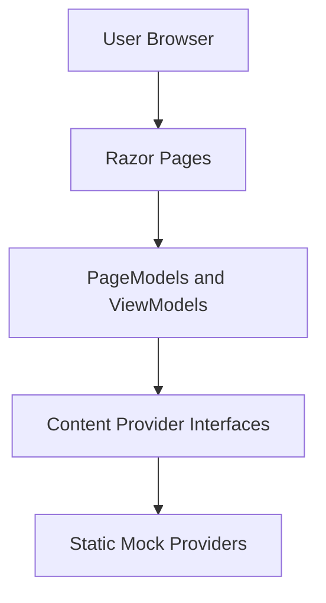
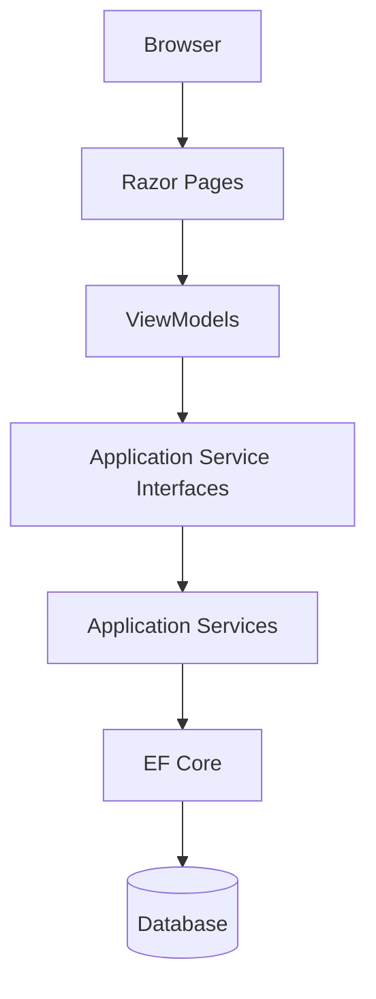

# Takyon — Technical Requirements Document (TRD)

## 1. Document Purpose

This document defines the proposed technical architecture for the Takyon public-facing website.

The initial phase focuses on the frontend using ASP.NET Core Razor Pages, C#, Bootstrap 5, and static/mock data.

The architecture must allow future backend integration without requiring a complete rewrite of the UI.

## 2. Technology Stack

| Technology | Purpose |
|---|---|
| C# | Application and page logic |
| ASP.NET Core Razor Pages | Server-rendered frontend |
| Bootstrap 5 | Responsive layout and UI components |
| HTML5 | Semantic page structure |
| CSS3 | Branding and custom styling |
| JavaScript | Client-side interactions and validation |
| Strongly typed ViewModels | Data passed to Razor views |
| Mock content providers | Initial data source |
| EF Core | Future database integration |
| ASP.NET Core Identity | Future admin authentication |
| SQL database | Future persistent storage |

EF Core, Identity, and database connectivity are not part of the initial implementation.

## 3. Architecture Overview

### 3.1 Initial Architecture



### 3.2 Future Architecture



The future architecture is conceptual. Final service boundaries and database design require approved business workflows.

## 4. Proposed Folder Structure

```text
Takyon/
│
├── Pages/
│   ├── Index.cshtml
│   ├── Index.cshtml.cs
│   │
│   ├── About/
│   │   ├── Index.cshtml
│   │   └── Index.cshtml.cs
│   │
│   ├── Leadership/
│   │   ├── Index.cshtml
│   │   └── Index.cshtml.cs
│   │
│   ├── Services/
│   │   ├── Index.cshtml
│   │   └── Index.cshtml.cs
│   │
│   ├── Industries/
│   │   ├── Index.cshtml
│   │   └── Index.cshtml.cs
│   │
│   ├── Projects/
│   │   ├── Index.cshtml
│   │   └── Index.cshtml.cs
│   │
│   ├── Clients/
│   │   ├── Index.cshtml
│   │   └── Index.cshtml.cs
│   │
│   ├── Partners/
│   │   ├── Index.cshtml
│   │   └── Index.cshtml.cs
│   │
│   ├── Contact/
│   │   ├── Index.cshtml
│   │   └── Index.cshtml.cs
│   │
│   ├── Shared/
│   │   ├── _Layout.cshtml
│   │   ├── _SiteHeader.cshtml
│   │   ├── _SiteFooter.cshtml
│   │   └── _ValidationScriptsPartial.cshtml
│   │
│   ├── _ViewImports.cshtml
│   └── _ViewStart.cshtml
│
├── Models/
│   └── ViewModels/
│
├── Content/
│   ├── Interfaces/
│   └── Mock/
│
├── Services/
│   └── (future application services)
│
├── wwwroot/
│   ├── css/
│   │   ├── site.css
│   │   └── components.css
│   │
│   ├── js/
│   │   ├── site.js
│   │   └── forms.js
│   │
│   ├── images/
│   └── lib/
│
├── Tests/
├── Program.cs
├── appsettings.json
├── Takyon.csproj
└── README.md
```

This is a proposed structure. Reuse existing project folders when appropriate instead of creating duplicate structures.

Do not create every folder if it is not needed.

## 5. Razor Pages Responsibilities

### Razor Pages

Responsible for:
- Rendering public pages.
- Defining page-specific markup.
- Binding strongly typed ViewModels.
- Including shared components.

### PageModels

Responsible for:
- Preparing page data.
- Calling content-provider interfaces.
- Coordinating page-level interactions.
- Applying appropriate model validation for prototype forms.

### ViewModels

Responsible for:
- Representing data required by the UI.
- Defining presentation-specific properties.
- Separating presentation requirements from future database entities.

### Content Providers

Responsible for:
- Returning repeatable content.
- Keeping datasets out of Razor markup.
- Providing a consistent access pattern for page data.

### Shared Components

Responsible for:
- Reusing the header and footer.
- Maintaining consistent visual patterns.
- Reducing duplicated Razor markup.

## 6. Proposed ViewModels

Create strongly typed ViewModels where needed.

### CompanyOverviewViewModel

Potential properties:
- CompanyName.
- Introduction.
- Mission.
- Vision.
- Values.
- ApprovedProofPoints.

### LeadershipMemberViewModel

Potential properties:
- Name.
- Title.
- Biography.
- ImagePath.

### SolutionViewModel

Potential properties:
- Title.
- Description.
- IconPath.
- DisplayOrder.

### IndustryViewModel

Potential properties:
- Name.
- Description.
- ImagePath.

### ProjectCaseStudyViewModel

Potential properties:
- Title.
- ClientName.
- Scope.
- Industry.
- ImagePath.

### ClientViewModel

Potential properties:
- Name.
- LogoPath.
- AltText.

### PartnerViewModel

Potential properties:
- Name.
- LogoPath.
- AltText.

### OfficeContactViewModel

Potential properties:
- OfficeName.
- Address.
- Phone.
- Email.

### ContactFormViewModel

Potential properties:
- Name.
- Email.
- Organization.
- Message.

### NewsletterFormViewModel

Potential properties:
- Email.
- Consent, if required by the approved form requirements.

These are proposed presentation models, not a finalized database schema.

## 7. Mock Data Strategy

### Requirements

- Keep repeatable content in centralized mock providers.
- Avoid embedding business datasets directly in Razor views.
- Use typed C# models.
- Register providers through dependency injection.
- Keep the initial providers read-only.
- Use one consistent data source pattern.

Mock content can be stored in C# providers or local JSON files. Select one approach based on the repository's existing conventions.

Do not duplicate the same content in multiple pages.

### Future Replacement Strategy

Initial:

`Razor Page → ViewModel → Content Provider Interface → Mock Provider`

Future:

`Razor Page → ViewModel → Application Service → Database`

The public page should continue to receive the same presentation model wherever practical, even when the underlying data source changes.

Do not design a complicated abstraction layer unless it provides a clear benefit.

## 8. Future Backend Requirements

The following features are planned for later phases.

### 8.1 Inquiry and Lead Management

Potential data:
- Contact details.
- Organization.
- Inquiry message.
- Inquiry category.
- Status.
- Created timestamp.

Final requirements and retention rules need approval.

### 8.2 Blog and Knowledge Base

Potential data:
- Article title.
- Slug.
- Summary.
- Body content.
- Author.
- Publication status.
- Published date.
- Metadata.

Draft, review, publishing, and revision workflows need definition.

### 8.3 Careers

Potential data:
- Job title.
- Department.
- Location.
- Description.
- Requirements.
- Closing date.
- Publication status.

Job application handling requires privacy, access-control, and retention decisions.

### 8.4 Projects and Portfolio

Potential data:
- Project title.
- Client.
- Industry.
- Scope.
- Images.
- Publication status.

Changes should be auditable if required by the approved workflow.

### 8.5 Investor Disclosures

Potential data:
- Disclosure title.
- Document type.
- Publication date.
- File location.
- Status.
- Audit information.

Regulatory requirements, approval workflows, and source documents must be confirmed before implementation.

## 9. Future Authentication and Authorization

Use ASP.NET Core Identity for future admin authentication.

Do not implement custom password storage.

The future design should include:
- Secure password handling.
- Authorization policies.
- Least-privilege access.
- Antiforgery protection.
- Appropriate session and cookie settings.
- Audit logging for sensitive operations.
- Secure handling of uploaded documents.
- Secret management outside source control.

Exact roles and permissions require approval.

No authentication implementation is permitted during the initial frontend phase.

## 10. Validation and Form Handling

### Initial phase

- Use client-side validation for Contact and Newsletter forms.
- Provide clear validation messages.
- Keep labels associated with controls.
- Avoid unnecessary JavaScript dependencies.
- Do not persist or transmit form submissions.
- Display an honest demo-only completion message.

### Future phase

- Add server-side validation.
- Validate all incoming data.
- Apply antiforgery protection.
- Add persistence and appropriate error handling.
- Add rate limiting where appropriate.
- Introduce email processing only after the workflow is approved.

Client-side validation must never be treated as a security boundary.

## 11. CSS and JavaScript Strategy

### CSS

Use Bootstrap 5 for:
- Grid layouts.
- Responsive navigation.
- Spacing utilities.
- Form controls.
- Standard component behavior.

Use custom CSS for:
- Brand tokens.
- Page-specific layouts.
- Reusable card styling.
- Hero sections.
- Logo grids.
- Focus states.
- Responsive refinements.

Do not mix Bootstrap with Tailwind CSS.

### JavaScript

Use minimal JavaScript for:
- Navigation behavior when required.
- Client-side validation.
- Demo form states.
- QR generation only after requirements are confirmed.

Prefer progressive enhancement and avoid unnecessary libraries.

## 12. Non-Functional Requirements

### Performance

- Optimize image sizes.
- Avoid unnecessary JavaScript.
- Minimize external network requests.
- Use responsive images where practical.
- Avoid duplicate assets.
- Configure static asset caching appropriately for deployment.

### Security

- Do not commit credentials or secrets.
- Use Razor's default output encoding.
- Avoid unsafe raw HTML.
- Do not implement fake security mechanisms.
- Keep demo forms non-persistent.
- Add real server-side protections when backend work begins.

### SEO

- Use unique page titles.
- Add appropriate meta descriptions.
- Use semantic headings.
- Keep URLs descriptive.
- Add Open Graph metadata where useful.
- Configure sitemap and robots files before public launch.
- Use structured data only when its claims are accurate.

### Browser Support

Target current stable versions of:
- Google Chrome.
- Microsoft Edge.
- Mozilla Firefox.
- Apple Safari.

Check responsive behavior on current Android and iOS browsers.

### Accessibility

Target WCAG 2.2 AA where practical.

Verify:
- Keyboard navigation.
- Focus indicators.
- Color contrast.
- Form labels.
- Validation messages.
- Image alternatives.
- Responsive readability.

## 13. Testing Strategy

### Build Verification

Run:

`dotnet build`

### Page Verification

Check:
- Every confirmed route.
- Internal navigation.
- Page titles.
- Shared layout.
- Images and logos.
- Footer links.

### Responsive Verification

Test:
- 320 px.
- 375 px.
- 768 px.
- 1024 px.
- 1440 px.

### Form Verification

Test:
- Empty fields.
- Invalid email.
- Valid input.
- Demo-only success state.
- Keyboard operation.

### General Quality Checks

- Check browser console errors.
- Verify local asset paths.
- Review source-content accuracy.
- Check keyboard accessibility.
- Run available automated tests.

Do not claim tests passed unless they were executed.

## 14. Deployment and Tooling

- Inspect the existing .NET SDK and target framework before changing project configuration.
- Keep the project buildable with `dotnet build`.
- Use Git and small, reviewable commits.
- Document setup and execution in README.md.
- Keep environment-specific configuration out of source control.
- Confirm hosting and deployment requirements before production deployment.

## 15. Technical Acceptance Criteria

- The application uses ASP.NET Core Razor Pages and Bootstrap 5.
- Confirmed public pages render correctly.
- Repeated content comes from typed ViewModels and mock providers.
- Razor markup does not contain duplicated business datasets.
- Responsive behavior has been checked.
- Form validation works without a backend.
- The build succeeds.
- No database, authentication, or CMS implementation has been added.
- Future integration points are documented.
