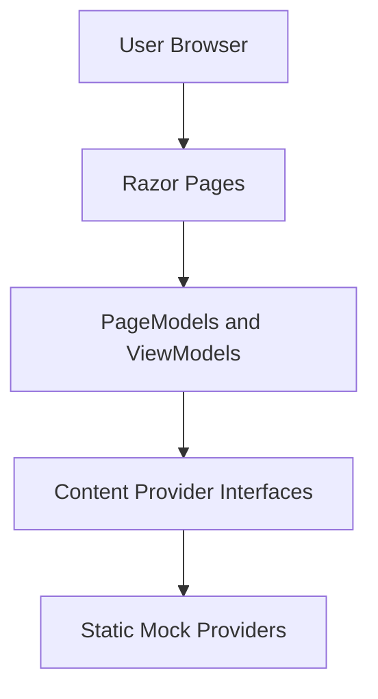
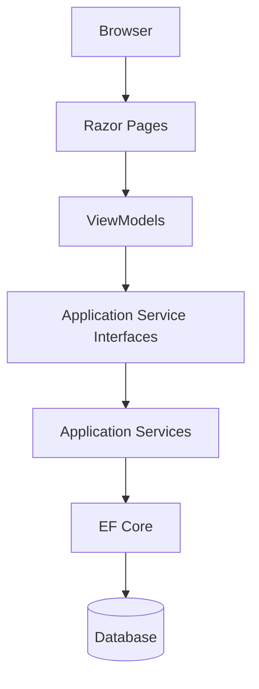

# Takyon — Technical Requirements Document (TRD)

## 1. Document Purpose

This document defines the proposed technical architecture for the Takyon public-facing website.

The initial phase focuses on the frontend using ASP.NET Core Razor Pages, C#, Bootstrap 5, and static/mock data.

The architecture must allow future backend integration without requiring a complete rewrite of the UI.

## 2. Technology Stack & Deployment Architecture

- **Framework:** ASP.NET Core Razor Pages on .NET 10 (`net10.0`).
- **Application Topology:** Single-domain monolithic application. Public Razor Pages (`.cshtml`) and their PageModels (`.cshtml.cs`) live in the same root project (`Takyon`). Frontend presentation and backend logic are part of the same application and deployment unit.
- **Data Architecture:** Strongly typed ViewModels and centralized content provider (`ITakyonContentProvider` / `MockTakyonContentProvider`) registered via ASP.NET Core Dependency Injection.
- **Styling & Client:** Bootstrap 5.3, custom CSS tokens (Takyon design system), semantic HTML5, and vanilla JavaScript (client-side form validation).

| Technology | Purpose | Implementation Status |
|---|---|---|
| C# 14 / .NET 10 | Application, PageModel orchestration, and domain models | Implemented & verified |
| ASP.NET Core Razor Pages | Server-rendered frontend pages and partials | Implemented & verified |
| Bootstrap 5.3 | Responsive grid layout and UI controls | Implemented & verified |
| HTML5 & CSS3 | Semantic markup and brand tokens | Implemented & verified |
| Vanilla JavaScript | Client-side validation and interactive states | Implemented & verified |
| Strongly typed ViewModels | Data contracts passed to Razor views (`Models/ViewModels/`) | Implemented & verified |
| Mock content provider | Centralized mock content provider (`Content/Mock/`) | Implemented & verified |
| EF Core | Future database integration replacing mock provider | Deferred (Future Phase 5) |
| ASP.NET Core Identity | Future admin authentication and access control | Deferred (Future Phase 6) |
| SQL Database | Future persistent storage | Deferred (Future Phase 5) |

EF Core, Identity, and database connectivity are explicitly not part of the initial implementation.

## 3. Architecture Overview

### 3.1 Initial Architecture



### 3.2 Future Architecture



The future architecture is conceptual. Final service boundaries and database design require approved business workflows.

## 4. Proposed Folder Structure

```text
Takyon/
│
├── Pages/
│   ├── Index.cshtml
│   ├── Index.cshtml.cs
│   │
│   ├── About/
│   │   ├── Index.cshtml
│   │   └── Index.cshtml.cs
│   │
│   ├── Leadership/
│   │   ├── Index.cshtml
│   │   └── Index.cshtml.cs
│   │
│   ├── Services/
│   │   ├── Index.cshtml
│   │   └── Index.cshtml.cs
│   │
│   ├── Industries/
│   │   ├── Index.cshtml
│   │   └── Index.cshtml.cs
│   │
│   ├── Projects/
│   │   ├── Index.cshtml
│   │   └── Index.cshtml.cs
│   │
│   ├── Clients/
│   │   ├── Index.cshtml
│   │   └── Index.cshtml.cs
│   │
│   ├── Partners/
│   │   ├── Index.cshtml
│   │   └── Index.cshtml.cs
│   │
│   ├── Contact/
│   │   ├── Index.cshtml
│   │   └── Index.cshtml.cs
│   │
│   ├── Shared/
│   │   ├── _Layout.cshtml
│   │   ├── _SiteHeader.cshtml
│   │   ├── _SiteFooter.cshtml
│   │   └── _ValidationScriptsPartial.cshtml
│   │
│   ├── _ViewImports.cshtml
│   └── _ViewStart.cshtml
│
├── Models/
│   └── ViewModels/
│
├── Content/
│   ├── Interfaces/
│   └── Mock/
│
├── Services/
│   └── (future application services)
│
├── wwwroot/
│   ├── css/
│   │   ├── site.css
│   │   └── components.css
│   │
│   ├── js/
│   │   ├── site.js
│   │   └── forms.js
│   │
│   ├── images/
│   │   ├── brand/
│   │   ├── leadership/
│   │   ├── projects/
│   │   ├── clients/
│   │   ├── partners/
│   │   └── badges/
│   └── lib/
│
├── Tests/
├── Program.cs
├── appsettings.json
├── Takyon.csproj
└── README.md
```

This is a proposed structure. Reuse existing project folders when appropriate instead of creating duplicate structures.

Do not create every folder if it is not needed.

## 5. Razor Pages Responsibilities

### Razor Pages

Responsible for:
- Rendering public pages.
- Defining page-specific markup.
- Binding strongly typed ViewModels.
- Including shared components.

### PageModels

Responsible for:
- Preparing page data.
- Calling content-provider interfaces.
- Coordinating page-level interactions.
- Applying appropriate model validation for prototype forms.

### ViewModels

Responsible for:
- Representing data required by the UI.
- Defining presentation-specific properties.
- Separating presentation requirements from future database entities.

### Content Providers

Responsible for:
- Returning repeatable content.
- Keeping datasets out of Razor markup.
- Providing a consistent access pattern for page data.

### Shared Components

Responsible for:
- Reusing the header and footer.
- Maintaining consistent visual patterns.
- Reducing duplicated Razor markup.

## 6. ViewModels (Presentation Contracts)

Strongly typed ViewModels reside in `Models/ViewModels/`. They define the presentation contract passed from PageModels to Razor views.

### SolutionItemViewModel (also referenced as SolutionViewModel)

Represents each of the 8 service categories defined in the 29-page company profile.

```csharp
namespace Takyon.Models.ViewModels;

public class SolutionItemViewModel
{
    public string Id { get; set; } = string.Empty;
    public string Title { get; set; } = string.Empty;
    public string Category { get; set; } = string.Empty; // "Core IT Solution" or "Specialized Service"
    public bool IsFeatured { get; set; }                 // Approved requirement: true for the 6 core brochure solutions
    public string Summary { get; set; } = string.Empty;
    public string Icon { get; set; } = string.Empty;
    public List<string> SubServices { get; set; } = new();
    public List<string> KeyHighlights { get; set; } = new();
    public List<string> WhyItMatters { get; set; } = new();
    public int DisplayOrder { get; set; }
}
```

*Implementation Alignment Note:* In the current codebase (`Models/ViewModels/SolutionItemViewModel.cs`), this property is implemented as `IsCoreBrochureSolution`, which flags `true` for the 6 core brochure solutions. To satisfy the approved architectural requirement, the property contract is documented as `IsFeatured`. The model supports all 8 service categories from the profile, and the data identifies exactly 6 featured categories (`IsFeatured = true`).

### CompanyOverviewViewModel
Represents corporate identity, milestones, core values, empanelments, and narrative:
- `CompanyName`, `Tagline`, `FoundedYear`, `Headquarters`, `BseStatus`, `CmmiStatus`, `GemStatus`, `Mission`, `Vision`
- `CoreValues` (`List<ValueItem>`)
- `Milestones` (`List<CompanyMilestone>`)
- `Empanelments` (`List<EmpanelmentItem>`)
- `OverviewParagraphs` (`List<string>`)

### LeadershipMemberViewModel
Represents corporate board of directors and executive leadership:
- `Name`, `Title`, `RoleCategory`, `Bio`, `ImagePath`, `DisplayOrder`

### IndustryVerticalViewModel
Represents industry coverage across public and enterprise sectors:
- `Id`, `Name`, `Description`, `Icon`, `FocusAreas` (`List<string>`), `DisplayOrder`

### ProjectCaseStudyViewModel
Represents verified project deployments from the A4 brochure:
- `Id`, `ProjectNumber`, `Title`, `Client`, `Location`, `Scope`, `Industry`, `ImagePath`, `IsFeaturedOnHome`, `DisplayOrder`

### ClientLogoViewModel
Represents institutional and enterprise client credentials:
- `Name`, `Sector`, `LogoPath`, `AltText`, `Description`

### PartnerLogoViewModel
Represents global OEM technology alliances:
- `Name`, `Category`, `LogoPath`, `AltText`, `IsFeatured`

### OfficeContactViewModel
Represents verified office directory and editorial transparency:
- `OfficeType`, `City`, `Address`, `Phone`, `Email`, `IsAddressVerified`, `UnresolvedNote`

### ContactFormViewModel & NewsletterFormViewModel
Represents client-side validated inquiry inputs:
- `FullName`, `Email`, `Organization`, `ServiceInterest`, `Message`
- `Email` (NewsletterFormViewModel)

## 7. Mock Data Strategy & Content Provider Architecture

### Centralized Mock Content Provider
- All mock business content is centralized in `MockTakyonContentProvider` (`Content/Mock/MockTakyonContentProvider.cs`).
- Content provider contracts are defined in `Content/Interfaces/ITakyonContentProvider.cs`.
- Strongly typed ViewModels reside in `Models/ViewModels/`.
- Dependency injection is configured in `Program.cs` via:
  ```csharp
  builder.Services.AddSingleton<ITakyonContentProvider, MockTakyonContentProvider>();
  ```
- Razor views receive strongly typed models through PageModels (`Pages/*.cshtml.cs`).
- Views render data supplied through PageModels and strongly typed ViewModels. Views must not directly access databases, execute SQL, or contain business-data retrieval logic.
- Shared layouts must not execute database queries or stored procedures.
- Keep PageModels thin and focused on page orchestration.
- Centralize mock content rather than duplicating business data across Razor views.

### Service Display & Taxonomy Integration
- The content model and mock content provider support all **8 service categories** represented in the approved 29-page company profile:
  1. Enterprise Networking
  2. Cyber Security
  3. Data Center Solutions
  4. Cloud Solutions (Cloud & Managed Services)
  5. Security & Surveillance
  6. AV & Collaboration Services (AV & Collaboration Solutions)
  7. SD-WAN & WAN Solutions
  8. Drone-Enabled Solutions (Drone-Enabled Monitoring)
- Each service has an `IsFeatured` boolean property.
- Exactly the **6 core solutions identified in the brochure** are marked `IsFeatured = true`:
  1. Enterprise Networking
  2. Cyber Security
  3. Data Center Solutions
  4. Cloud Solutions
  5. Security & Surveillance
  6. AV & Collaboration Services
- The remaining 2 profile categories (`SD-WAN & WAN Solutions` and `Drone-Enabled Solutions`) remain available in the complete service catalog (`IsFeatured = false`).
- The Home page selects and displays the 6 featured solutions using `IsFeatured = true` (via `GetSolutions(coreOnly: true)`).
- The Services page receives the full eight-category catalog, presenting the 6 core brochure pillars alongside the 2 specialized profile categories.

### Source-of-Truth Discrepancy Handling in Mock Data
Where the 29-page company profile and 8-page A4 brochure disagree, discrepancies are documented next to the affected mock data and exposed via `GetUnresolvedDiscrepancies()`:
1. **Lucknow HQ Phone:** Company Profile (p.29) lists `(022) 665 6617` (Mumbai 022 STD code typo), whereas Brochure (p.2 & p.8) lists `(0522) 665 6617` (Lucknow 0522 STD code). The correct Lucknow STD code `(0522) 665 6617` is used provisionally in mock data with inline comments, while the discrepancy is preserved and documented for formal confirmation.
2. **Delhi Office Address:** Company Profile (p.29) lists `911, 9th Floor, DLF Jasola Vihar, New Delhi 110025` while Brochure (p.2 & p.8) lists `307, DLF Tower-B, Jasola District Center, New Delhi 110025`. Because this discrepancy is unresolved, the physical address is withheld from publication with a transparent notice until confirmed by stakeholders.
3. **Contact QR Payload:** Dynamic QR code generation is withheld until the official payload specification (vCard vs verified company profile URL) is confirmed.

### Future Provider Replacement Strategy

The architectural separation allows `MockTakyonContentProvider` to be replaced by a real EF Core-backed provider implementing the same contracts:

Initial:
`Razor Page → ViewModel → ITakyonContentProvider → MockTakyonContentProvider`

Future:
`Razor Page → ViewModel → ITakyonContentProvider → EfCoreTakyonContentProvider → ApplicationDbContext → SQL Database`

**Compatibility Guarantee and Boundaries:**
- The target is **zero changes to Razor views when the provider is replaced**, assuming the existing ViewModel contracts remain compatible.
- PageModels and DI registration in `Program.cs` (`builder.Services.AddScoped<ITakyonContentProvider, EfCoreTakyonContentProvider>();`) will be updated to bind to the persistent data provider.
- Views will continue to consume the exact same ViewModel types, guaranteeing that presentation markup and layout need zero rewrites.
- Do not claim that PageModels, service registration, or other application components will require zero changes unless the implementation actually guarantees it.

## 8. Future Backend Requirements

The following features are planned for later phases.

### 8.1 Inquiry and Lead Management

Potential data:
- Contact details.
- Organization.
- Inquiry message.
- Inquiry category.
- Status.
- Created timestamp.

Final requirements and retention rules need approval.

### 8.2 Blog and Knowledge Base

Potential data:
- Article title.
- Slug.
- Summary.
- Body content.
- Author.
- Publication status.
- Published date.
- Metadata.

Draft, review, publishing, and revision workflows need definition.

### 8.3 Careers

Potential data:
- Job title.
- Department.
- Location.
- Description.
- Requirements.
- Closing date.
- Publication status.

Job application handling requires privacy, access-control, and retention decisions.

### 8.4 Projects and Portfolio

Potential data:
- Project title.
- Client.
- Industry.
- Scope.
- Images.
- Publication status.

Changes should be auditable if required by the approved workflow.

### 8.5 Investor Disclosures

Potential data:
- Disclosure title.
- Document type.
- Publication date.
- File location.
- Status.
- Audit information.

Regulatory requirements, approval workflows, and source documents must be confirmed before implementation.

## 9. Future Authentication and Authorization

Use ASP.NET Core Identity for future admin authentication.

Do not implement custom password storage.

The future design should include:
- Secure password handling.
- Authorization policies.
- Least-privilege access.
- Antiforgery protection.
- Appropriate session and cookie settings.
- Audit logging for sensitive operations.
- Secure handling of uploaded documents.
- Secret management outside source control.

Exact roles and permissions require approval.

No authentication implementation is permitted during the initial frontend phase.

## 10. Validation and Form Handling

### Initial phase

- Use client-side validation for Contact and Newsletter forms.
- Provide clear validation messages.
- Keep labels associated with controls.
- Avoid unnecessary JavaScript dependencies.
- Do not persist or transmit form submissions.
- Display an honest demo-only completion message.

### Future phase

- Add server-side validation.
- Validate all incoming data.
- Apply antiforgery protection.
- Add persistence and appropriate error handling.
- Add rate limiting where appropriate.
- Introduce email processing only after the workflow is approved.

Client-side validation must never be treated as a security boundary.

## 11. CSS and JavaScript Strategy

### CSS

Use Bootstrap 5 for:
- Grid layouts.
- Responsive navigation.
- Spacing utilities.
- Form controls.
- Standard component behavior.

Use custom CSS for:
- Brand tokens.
- Page-specific layouts.
- Reusable card styling.
- Hero sections.
- Logo grids.
- Focus states.
- Responsive refinements.

Do not mix Bootstrap with Tailwind CSS.

### JavaScript

Use minimal JavaScript for:
- Navigation behavior when required.
- Client-side validation.
- Demo form states.
- QR generation only after requirements are confirmed.

Prefer progressive enhancement and avoid unnecessary libraries.

## 12. Non-Functional Requirements

### Performance

- Optimize image sizes.
- Avoid unnecessary JavaScript.
- Minimize external network requests.
- Use responsive images where practical.
- Avoid duplicate assets.
- Configure static asset caching appropriately for deployment.

### Security

- Do not commit credentials or secrets.
- Use Razor's default output encoding.
- Avoid unsafe raw HTML.
- Do not implement fake security mechanisms.
- Keep demo forms non-persistent.
- Add real server-side protections when backend work begins.

### SEO

- Use unique page titles.
- Add appropriate meta descriptions.
- Use semantic headings.
- Keep URLs descriptive.
- Add Open Graph metadata where useful.
- Configure sitemap and robots files before public launch.
- Use structured data only when its claims are accurate.

### Browser Support

Target current stable versions of:
- Google Chrome.
- Microsoft Edge.
- Mozilla Firefox.
- Apple Safari.

Check responsive behavior on current Android and iOS browsers.

### Accessibility

Target WCAG 2.2 AA where practical.

Verify:
- Keyboard navigation.
- Focus indicators.
- Color contrast.
- Form labels.
- Validation messages.
- Image alternatives.
- Responsive readability.

## 13. Testing Strategy

### Build Verification

Run:

`dotnet build`

### Page Verification

Check:
- Every confirmed route.
- Internal navigation.
- Page titles.
- Shared layout.
- Images and logos.
- Footer links.

### Responsive Verification

Test:
- 320 px.
- 375 px.
- 768 px.
- 1024 px.
- 1440 px.

### Form Verification

Test:
- Empty fields.
- Invalid email.
- Valid input.
- Demo-only success state.
- Keyboard operation.

### General Quality Checks

- Check browser console errors.
- Verify local asset paths.
- Review source-content accuracy.
- Check keyboard accessibility.
- Run available automated tests.

Do not claim tests passed unless they were executed.

## 14. Deployment and Tooling

- Inspect the existing .NET SDK and target framework before changing project configuration.
- Keep the project buildable with `dotnet build`.
- Use Git and small, reviewable commits.
- Document setup and execution in README.md.
- Keep environment-specific configuration out of source control.
- Confirm hosting and deployment requirements before production deployment.

## 15. Technical Acceptance Criteria

- The application uses ASP.NET Core Razor Pages and Bootstrap 5.
- Confirmed public pages render correctly.
- Repeated content comes from typed ViewModels and mock providers.
- Razor markup does not contain duplicated business datasets.
- Responsive behavior has been checked.
- Form validation works without a backend.
- The build succeeds.
- No database, authentication, or CMS implementation has been added.
- Future integration points are documented.
